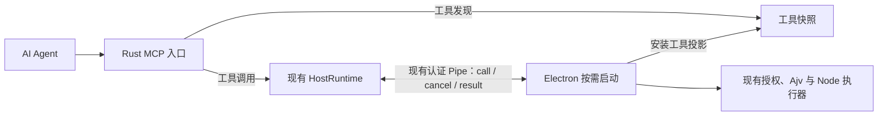

# Rust 常驻 MCP 网关与 Electron 按需执行：重构设计

日期：2026-11-17。状态：用户已确定只实施方案 A，并授权修订、审核无阻塞后开发；实际实施状态见进度记录。

## 1. 目的与范围

保持 WebTools MCP 随时可访问，同时恢复 Electron 在无窗口、无任务、无用户后台会话时退出的资源约定。采用 Rust NativeHost 内置 MCP 入口、Electron 按需执行现有插件的方案。对用户仍是一个 WebTools，对插件作者仍是现有 `mcpTool` 和 `McpToolHandler`。

本次是独立的小重构，包含协议入口、必要的 IPC 请求处理、配置所有权和现有设置页适配。不扩展 MCP 工具种类，不重写插件运行时，不推进插件市场、P6 后续模板覆盖或 WPF 功能迁移，也不重新设计搜索、超级面板或插件窗口。

## 2. 对齐依据与源码基线

工作目录：`D:\SystemDefault\Desktop\webtools-rs-plugin-platform-work`。调查时 HEAD 为 `f5a9073`，存在大量已修改和未跟踪的插件平台代码；实际基线为 HEAD 加当时工作树，不能仅检出该提交来实施。执行前重新记录受影响文件差异及 SHA-256，保留用户现有修改。

聊天依据：“分析 Super Panel 翻译按钮偶发失效”（threadId：`01a14a68-5bb5-7c20-a9e7-09f31940dee3`）。读取的相关记录包括 P5 收尾、P6 第一/第二项交付、用户对开发链路的测试通过反馈及 MCP 常驻调查。聊天是需求/交付记录，当前代码与文档负责说明具体实现。

| 依据 | 本任务继承的约定 |
| --- | --- |
| [插件平台主计划](../plans/2026-10-28-webtools-plugin-platform-parity-plan.md)，第 1、3、P0/P1/P4/P5/P6 节 | 用户不必理解 Rust/Electron 分工；异步启动反馈不增加固定等待；按实际窗口、任务和会话保活；安装插件与用户数据兼容 |
| [P5 MCP](../../p5-builtin-mcp-agent-connection.md) | 设置 → AI、统一 HTTP 入口、按插件开关、Agent 一键配置与备份、工具命名与无前台手势 |
| [P5 定时任务](../../p5-schedule-management.md) | Rust 常驻调度与按需唤醒；Manager 管理调用限定主窗口主 frame；后台任务不抢焦点 |
| [插件主题契约](../../plugin-window-theme-contract.md) | Host 设置页沿用产品令牌与公共控件；插件业务样式可选；不强制第三方采用 UI CSS |
| [P6 开发链路](../../p6-development-workflow.md)、[兼容约定](../../p6-toolchain-compatibility.md) | 正式安装与开发会话隔离；热重载/重连/上下文模拟保留；版本号含义独立 |

P5 的历史验收状态保留。P6 第二项聊天已有用户通过反馈，主计划文字仍含“待用户实机确认”；这是文档同步差异，不属于本任务重新验收或重置状态的理由。当前 SDK/生成器源码为 1.16.1，不因宿主内部迁移强制升级 SDK、Manifest 或插件包。

### 已核实的改造点

- `app.rs:2154` 读取 Native profile 根目录的 `plugin-mcp-settings.json` 并添加 `mcp-bootstrap`。
- `HostOptions.profile` 为 `<nativeProfile>/runtime/wt-manager-profile`，但 `host.rs` 仅在 `--phase4g-manager-test` 下把它传给 Electron；正式 Manager 的 userData 仍是 `%APPDATA%/Nook`，与正式 Native profile 根目录相同。必须依据实际启动参数选择数据目录，不能把隔离测试的嵌套目录当正式目录。
- `main.ts:532` 的退出判据受 MCP 监听状态阻挡；`1113–1122` 恢复 Electron 监听；`1244–1277` 提供现有 Manager MCP 管理入口。
- `PluginMcpPanel.vue` 已有服务卡、插件分组开关、刷新、连接弹窗、完整 JSON 和一键配置。旧开关直接取反 `running`，迁移后须改用持久偏好 `enabled`。
- `PluginManager.listMcpTools()` 负责已安装工具发现；`PluginMcpService.callTool()` 包含实时授权、Ajv 输入/输出检查和 `NodeCommandExecutionAdapter` 调用。
- `HostSession.begin_feature_quick_result()` 先调用同步 `acquire()`；`HostSession.request()` 等待期间会接收并处理其他消息，但仍占用 supervisor 调用栈。仅仿照发送部分并不能完成非阻塞管理。
- 旧 P5 验收脚本包含独立 Electron 启动和固定 `1.17.0` 样例文件名，需要改为实际 Rust 托管链路和显式传入的当前样例包。

这些是源码事实，不是本次运行测试结果。报告里的内存增量、代码行数和启动耗时均不作为已测结论。

## 3. 已选择的架构

| 方案 | 决策及理由 |
| --- | --- |
| A：Rust 内置入口，Electron 按需执行 | 用户已选择。延续已有常驻宿主，避免新增常驻 Node 进程；复用现有插件执行权威 |
| Electron 继续常驻 | 无法达到 Electron 空闲退出目标 |

协议层优先采用官方 [rmcp](https://github.com/modelcontextprotocol/rust-sdk#stateless-streamable-http)，选择与现有 TS SDK/客户端协商版本相容的稳定发布并锁定依赖；不直接追随 main 的草案协议。仅启用所需 server/Streamable HTTP 能力。协议细节交给 SDK，Rust 自有逻辑集中于设置、发现、路由和生命周期。监听运行在 Slint UI 线程之外；绑定失败只影响 MCP，不终止启动器。

Electron 继续拥有插件安装与完整性校验、当前授权、Ajv 校验、命令运行、存储、SecretStore 和 Agent 配置写入。`mcpTool` 的声明、`pluginId.featureId` 命名、`mcpInput`、输出与 `gesture=false` 语义保持。

## 4. 产品与前端体验契约

### 4.1 入口与操作

继续使用 Manager → 设置 → AI 的现有 MCP 区域。保留服务总开关、插件工具分组/展开、插件级开关、刷新、连接 AI Agent、复制完整配置、一键配置和原配置备份。MCP 仍是平台内置能力；不要求安装服务插件、运行开发命令或理解宿主进程。

沿用当前 `SettingsView.vue`、`PluginMcpPanel.vue` 与 `src/styles/tokens.css` 的布局、字体、按钮、开关、卡片和深浅色令牌。状态变更在原位置反馈，不弹出新的管理窗口；不为后台 MCP 调用显示插件窗口、抢焦点或唤出搜索框。普通插件恢复/失焦/Esc、分离窗口、Translation、子输入和超级面板交互继续由既有逻辑负责。

### 4.2 状态含义与固定文案

总开关反映用户保存的 `enabled`；服务健康反映 `running/phase`。端口故障不得把用户偏好悄悄改为关闭。内部 Electron 启停不映射为服务反复开关，不在普通界面展示 PID、Pipe 或 runtime generation。

| 场景 | 页面行为与文案 |
| --- | --- |
| 初次读取 | 原区域显示“正在读取本地 MCP 服务状态…”；防重复提交，读取失败不显示成“已关闭” |
| 已关闭 | “开启后可连接本机 AI Agent，服务使用固定地址和访问令牌。” |
| 监听建立中 | “正在启动本地 MCP 服务…”；开关操作中，完成即更新，不增加固定展示时间 |
| 已监听 | “服务运行中。关闭管理窗口后仍可调用；退出 WebTools 后服务停止。” |
| 首次工具同步中 | 工具区域显示“正在同步插件工具…”；不能当作“暂无工具” |
| 有效空工具集 | 保留现有“暂无插件提供工具”说明与安装提示 |
| 绑定失败 | “无法启动本地 MCP 服务，请检查端口 {port} 是否被占用。”；显示“重试”，保留 enabled 偏好 |
| Rust 不可用/能力不匹配 | “无法连接本地 MCP 服务，请确认 WebTools 托盘仍在运行。”；允许刷新恢复，保留上次可信数据但标记不可用 |
| 配置无法读取 | “无法读取本地 MCP 服务配置，原文件已保留。”；不自动生成新令牌覆盖旧文件 |
| Agent 配置成功 | 保留现有“配置已写入，原文件已备份。请在 Agent 中重连 MCP，必要时重启 Agent。” |

迁移本身不要求用户重连 Agent；上表重连提示只属于用户显式写入 Agent 配置的既有操作。连接弹窗的“已配置”仅表示配置匹配，不能改写为“Agent 在线”。服务未就绪时禁止写入无效连接配置。

加载、错误和成功反馈使用既有页面样式，支持键盘开关、Tab/Enter/Space、弹窗焦点进入/返回和 Esc，错误文本可读。操作结束恢复按钮；失败不清空插件分组，不把 `IpcResult.ok=false` 当成功，不让离开页面后的迟到响应覆盖新页面状态。覆盖深/浅/跟随系统、100%/150% DPI、窄窗口和长插件名。

## 5. 数据、接口与所有权

### 5.1 设置：保留现有完整配置位置

Rust 成为 MCP 配置唯一写者，采用当前 Manager 的实际 userData：正式模式为 Native profile 根目录（默认 `%APPDATA%/Nook`），带 `--phase4g-manager-test` 的隔离模式为 `<nativeProfile>/runtime/wt-manager-profile`。设置和工具快照均放在所选目录；不移动插件数据。启动参数在同一处解析并显式传给存储模块。首次迁移规则：

1. 当前 Manager 完整配置位置存在且合法：原样继承 enabled、port、token、disabledPlugins。正式模式忽略嵌套旧测试配置；隔离模式的根目录旧 boolean marker 不覆盖完整设置。
2. 完整配置缺失、根目录有合法完整配置：原子复制到规范位置，保留旧文件用于回滚。
3. 完整设置缺失、只有隔离模式旧 marker 或都不存在：初始化关闭状态并产生一次令牌；marker 不能代替完整授权配置自动开启。正式设置路径上已有不完整/损坏文件仍按第 4 条处理。
4. 规范文件存在但损坏：保留文件，报告配置错误并停止监听，不从其他位置静默取代它。

端口范围 1024–65535，默认 24459；令牌沿用现有 32–128 字符 base64url 规则，新令牌用操作系统安全随机源生成。设置通过原子替换保存；写入失败不向 UI 报保存成功。隔离模式旧 marker 后续不再写、不再参与启动判定；正式根目录完整设置仍是权威文件。测试和生产均使用显式 Manager profile 解析入口。

保持旧设置 JSON 字段和缺省行为。手动总开关变更仅在绑定/关闭操作及保存成功后提交；启动时已保存 enabled=true 而绑定失败时保留偏好并报告 error。关闭会拒绝新请求并取消当前 MCP 调用，最终释放 MCP 所有权；已经产生的副作用不回滚。

### 5.2 工具投影

新增 `mcp-tools-projection.json`，与规范设置同目录，schemaVersion=1。字段：`schemaVersion`、`revision`、`tools`；工具条目包含 pluginId、featureId、title、description、inputSchema 和可选 outputSchema。它只来自正式安装、已校验的 `listMcpTools()`；不包含开发会话、脚本路径、插件数据、令牌或授权凭据。有效空数组也是完成同步的快照。

Electron 在初始化、安装/升级/卸载、启停和权限变化后推送完整快照，Rust 原子保存后替换可见版本。每条 Pipe 的投影 revision 绑定连接代次，旧连接迟到更新不能覆盖新连接；落盘失败不报告“同步完成”，保留之前有效版本。HTTP `tools/list` 对快照施加 disabledPlugins 过滤，Manager 管理列表仍能看到 MCP 级关闭的插件及其工具，便于重新开启。

有有效快照时启动、initialize、ping、tools/list 均不启动 Electron。缺失/损坏快照时 Rust 仍先启动监听；首次 tools/list 或 tools/call 合并触发一次 `mcp-sync` 唤醒，等待有界同步后响应。同步失败返回明确错误，不能假装空列表；同步结束释放临时所有权。迁移验收分别覆盖“已有快照”和“首次建立快照”，不把首次同步例外写成永久后台启动。

每次调用都由 Electron 重新授权。缓存命中不等于有权执行，旧插件包或权限变化后不得使用快照绕过检查。

### 5.3 Pipe 与 Manager 契约

在现有 Pipe 的能力协商新增 `plugin-mcp-gateway-v1`；匹配该能力后才发送 MCP 消息。保留现有 PID 校验、长度前缀 JSON 和 4 MiB 帧上限，不借本任务重写整个 IPC。

| 消息 | 方向与职责 |
| --- | --- |
| `mcp-tools-update-v1` | Electron → Rust：完整工具投影；确认落盘结果 |
| `mcp-call-v1` | Rust → Electron：内部 callId、deadlineUnixMs、toolName、arguments；按 callId 返回结果 |
| `mcp-call-cancel-v1` | Rust → Electron：callId；幂等请求取消；取消确认不等于副作用撤销 |
| `mcp-admin-get-v1` | Manager Main → Rust：状态及连接参数 |
| `mcp-admin-set-enabled-v1` | Manager Main → Rust：enabled；相同 true 也支持错误后的重试 |
| `mcp-admin-set-plugin-enabled-v1` | Manager Main → Rust：pluginId、enabled |
| `mcp-admin-preferences-v1` | Manager Main → Rust：disabledPlugins |

继续使用 `window.desktop.pluginMcp` 的现有方法名、参数和 `IpcResult` 包装；`setPluginEnabled` 仍返回原有结果结构。新增内部类型集中在 `src/shared/plugin-mcp-contracts.ts`，由 ipc.ts 导出；Rust 对等类型放 `crates/webtools-ipc/src/mcp.rs`。管理方法只允许 Manager 主 frame。连接参数仅返回现有可信 Manager 路径，不进入工具投影或普通日志。

迁移中先定义内部 `McpGatewayStatus`，现有公共 `PluginMcpStatus` 及页面初始化保持到最终切换。Rust 网关先在隔离实例验证，前端适配完成后同批切换公共类型、管理接口、配置写权、监听、bootstrap 和退出判断；此前普通入口仍可用，最终不保留产品双模式。

`PluginMcpStatus` 保留 `running` 判别与运行时 url/token 字段，增加 `enabled:boolean`、`phase:'disabled'|'starting'|'running'|'error'`、`catalogReady:boolean`、`activeCalls:number`、可选 `error:{code:string;message:string}`。`running=true` 才含 url/token；未监听时 running=false，错误时也可能 enabled=true。phase 表示监听生命周期，绝不表示 Electron 冷启动。前端打开页面、显式刷新、操作完成及页面重新激活时读取状态；不增加常驻毫秒轮询或另一套状态总线。

不支持新能力的旧/WPF 宿主显示不可用提示，保持其他设置页可用。本任务不实现双 MCP 监听器或自动降级到旧 Electron 监听。

## 6. 请求与生命周期规则

- Rust 为每次调用产生独立内部 callId，不直接用跨客户端可能重复的 JSON-RPC id 作为全局键；映射不允许客户端互相取消。当前共享 URL/Bearer 的无会话传输不提供稳定客户端身份；不为此引入会话、额外客户端标识或要求客户端修改配置。
- 全局最多 8 个被接纳的 MCP 调用，包含等待启动和正在执行者；第 9 个快速返回工具繁忙错误，不新增无界等待队列。Node 执行器现有共享上限仍生效。
- 总预算初值 60 秒（含排队、Electron 启动、现有 30 秒命令期限与清理）；HTTP 接收 body 期限仍为 15 秒，不能把它误当工具执行期限。内部用单调时钟计时，发往 Electron 的截止时间只用于传递剩余预算，不跨崩溃重置预算。
- 所有 MCP 调用共享已有 Electron 启动实例。收到 `electron-host-ready` 且当前请求所有权经既有协商确认后才能投递；不等待 Manager renderer 可见。
- 接纳→等 ready→同步请求所有权→投递→完成，是显式状态。MCP 路径的所有权握手也采用非阻塞处理；只把工具命令改成 send 而留下长同步 acquire 不算完成。
- `pump()` 和遗留 `request()` 的收包分支统一识别 MCP ack，不能把 MCP 结果交给只识别 Quick Result 的处理函数后丢弃。不对本任务无关的调用全面异步化。
- 已投递（含部分写入、送达情况不明）的调用断连后返回“调用中断，执行结果未知”，不自动重放。未投递请求可随现有启动重试继续等待，但受同一预算限制；不做 exactly-once 承诺。
- 仅将 SDK 能绑定到原请求上下文的取消、原请求连接断开、服务关闭和内部超时传到对应 Electron AbortController。独立 POST 的 `notifications/cancelled` 若只有 requestId、无法证明归属，则按 SDK/协议通知规则接收但不取消任何调用，绝不搜索全局同号请求。该无会话模式不承诺跨 POST 精确取消；验证记录明确这一限制。断开与取消都不是执行停止的证明；在确认执行器退出或进程已回收前保留运行任务所有权和并发槽位，不能只因 HTTP 等待者结束就放掉它们。
- 每个已接纳请求先持有 owner。正常最后一次执行结束时，先建立/续期 `mcp-cooldown`，再释放请求 owner，避免退出空隙。冷却初值 15 秒，从最后一次执行真正结束计算；期间新请求取消旧冷却截止。到期只释放 MCP 冷却，不关闭仍有窗口/定时任务/用户后台会话的 Electron。
- 冷却、请求完成与新请求接纳在同一调度所有权路径串行处理；旧定时器带代次，不能释放新冷却。复用等待/消息唤醒，不新增 1–2ms 忙轮询。
- 退出托盘停止接收并取消 MCP 工作，沿用现有进程树回收。MCP 关闭只停止 MCP 工作，不影响其他功能。

## 7. 兼容与错误

维持 `127.0.0.1:<原端口>/mcp`、原 token、Bearer 校验、拒绝 Origin、Host 检查及 64 KiB 请求体上限。传输的初始化、通知、Accept、协议版本和 HTTP 状态码遵循被锁定 SDK；不把 SDK 标准方法处理简化成自制 POST 路由。401/403/413 及不支持方法行为以协议与旧入口基线逐项验证。

工具错误使用 MCP 工具结果的 `isError` 与可理解文字；传输/JSON-RPC 格式错误交给 SDK。保留输入/输出 Schema 错误、插件停用/权限撤销错误。新增错误分类：服务不可用、工具同步失败、工具繁忙、启动超时、调用取消、执行结果未知。Manager 的错误仍通过 `IpcResult`，不暴露原始堆栈或敏感参数。

Agent 配置文件的写入逻辑、目标位置、合并和备份保留在 Electron。本任务的自动测试仅操作隔离目录；真实 Agent 联调使用已有条目，不主动改写用户配置。

## 8. 验收与交付

| 编号 | 必须可观察到的结果 |
| --- | --- |
| A1 | 有效工具快照、MCP 开启、托盘冷启动：Rust 保持监听；无其他拥有者时 Electron/UtilityProcess 为 0 |
| A2 | initialize/ping/tools/list 不唤醒 Electron；首次无快照同步是明确记录的一次性例外 |
| A3 | 冷调用仅启动一个 Electron，工具返回正确；连续调用热复用，最后完成 15 秒冷却后自然退出 |
| A4 | Manager/普通插件/分离窗口/Translation/定时任务仍遵守既有焦点与生命周期；MCP 不抢焦点，不误关它们 |
| A5 | 关闭 Manager 不停止服务；关闭 MCP 后不再监听；退出托盘回收全部本任务进程和端口 |
| A6 | URL/token/disabledPlugins/数据在升级重启后保持；MCP 级关闭和插件全局停用语义不同且均可恢复 |
| A7 | 输入/输出 Schema、权限撤销、8+1 并发、取消、超时、崩溃未知结果、迟到 ack/投影均有定向验证 |
| A8 | 原 AI 设置体验、Agent 配置备份与错误恢复、深浅色、DPI、键盘和弹窗交互通过实际打包版检查 |
| A9 | 正式工具可发现，开发会话不投影；P6 热重载、断线重连、上下文模拟与既有 SDK 保持 |
| A10 | 同机同配置对比进程组 Private Bytes/Working Set、空闲 CPU、冷/热调用 P50/P95；新实现总体空闲 Private Bytes 的改善须超过重复窗口观察波动；不给未测数字贴“通过”标签 |

冷调用采样至少 20 次；启停回收验证 50 轮（可通过隔离测试注入较短冷却验证状态机，正式 15 秒路径另做实测）。报告区分自动通过、人工待测和历史证据；实际启动多个客户端不代表已验证所有客户端/版本。

空闲比较每场景使用 3 个等长窗口，报告各窗口进程组 Private Bytes 中位数及范围；新实现每个窗口中位数均低于旧实现最小窗口中位数，才确认本次测量中的净收益。CPU 对照纯 NativeHost 空闲观察范围；50 轮后进程/句柄不得持续增长。Rust 增量内存不设无实测依据的 15 MiB 硬门槛。故障验收包括端口占用、畸形请求、长期未完成调用、Electron 崩溃和受监督 MCP 任务的可展开 panic，验证 Launcher/热键/托盘可用；不据此承诺进程级 abort/OOM 隔离。

交付沿用 `webtoolstest` 的独立版本目录，包含完整 Rust+Electron 预览、复用的当前 platform-playground 包、自动证据、内存/延迟对照及中文人工步骤。无需为这项内部迁移另发 SDK。优先小范围验证协议与路径兼容，再完成主链路，最后前端与打包验收；步骤见配套计划。

## 9. 回滚与实施者选择

开发中保留旧 Electron 入口直至切换任务完成；任一运行模式仅一个端口拥有者。正式切换后只运行 Rust 入口，失败明确提示，不自动并行启动 Node 或旧 Electron 入口。

回滚以本任务的独立提交为单位；恢复旧监听、bootstrap 与保活判据，并从规范位置读取原配置。旧 marker 原本可能不一致，回滚步骤需根据同一 enabled 重建它，不能只恢复代码假定启动行为一定正确。保留新增快照和原始配置，兼容回滚版本读取；禁止清空 profile 或回退整棵用户工作树。

实施者可决定 Rust 模块内部组织、SDK稳定版本及必需依赖的最小集合，前提是先通过协议验证并在锁文件记录；兼容问题在方案 A 内修复，未解决时保持旧正式入口并报告具体阻碍，不转向独立 Node 方案。15 秒冷却与 60 秒总预算通过内部参数提供初始值，调整需附测量原因，不新增面向普通用户的底层调参界面。
